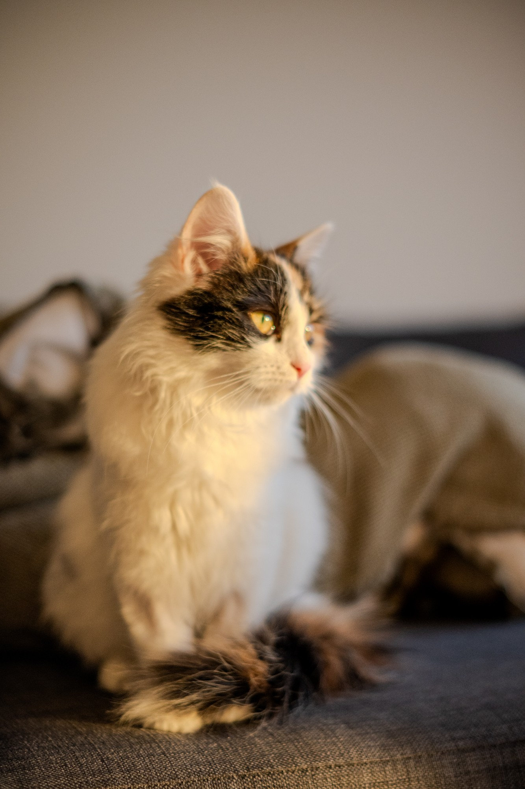

This post is a cheat sheet. It's unlisted, so only people with the link can find it. Copy what you need into your own posts.

A draft post (add `draft: true` at the top) is never published; you can see drafts locally with `hugo server -D`.

## Making a post

Every post is a folder with an `index.md` inside, plus any images it uses:

```text
content/journal/
  my-first-post/          ← a post not in any folder
    index.md
    photo.jpg
  projects/               ← a folder (create as many as you like)
    _index.md             ← just:  ---  title: "Projects"  ---
    tribot/
      index.md
```

The top of `index.md` holds the details: `title`, `date`, an optional one-line `description` (shown in lists, search results and link previews), and optional `tags`. Posts in a folder are listed oldest first.

## Text

Regular paragraphs, **bold**, *italics*, `inline code`, [links](https://example.com) and <mark>highlighted text</mark>.

> Block quotes look like this. Good for pulling out a line you want to land.

### Lists

- Bullet points
- With nesting
  - like this
1. Or numbered
2. steps

### Callouts


A plain note. Markdown **works** in here.



Use `tip`, `warning` or `idea` for different colors.



Something to watch out for.


## Images

A plain Markdown image becomes a full-width figure. The text in quotes is the caption:





To wrap text around an image, use the `figure` shortcode with `align="right"` or `align="left"`, and optionally a `width`. This paragraph flows around the photo on the right. On a phone, the image sits above the text at full width instead, because there isn't room to wrap.

Keep writing and the text keeps wrapping until it clears the image. Headings, tables and full-width figures always start below a floated image, so nothing collides.

For a big moment, `align="wide"` lets an image spill past the text column:



## Equations

Inline math sits in a sentence, like $E = mc^2$ or \(\alpha + \beta\). Display math gets its own line:

$$
\mathcal{L}(\theta) = -\sum_{i=1}^{N} \log p_\theta(y_i \mid x_i)
$$

\[
\text{softmax}(z)_j = \frac{e^{z_j}}{\sum_{k} e^{z_k}}
\]

Write a literal dollar sign as `\$`, so prices like \$20 don't turn into math.

## Tables

A standard Markdown table. Put `{.striped}` or `{.compact}` on the line right after it to change the style:

| Model | Accuracy | Dialect gap | Verdict |
|:------|---------:|------------:|:--------|
| Baseline | 81.2 | 9.4 | Large gap |
| + Adapter | 84.7 | 3.1 | Better |
| + Adapter + data | **86.9** | **1.2** | Best |
{.striped}

Colored cells use `text`. Colors: green, red, amber, blue, purple, gray.

## Code

```python
def softmax(z):
    e = np.exp(z - z.max())
    return e / e.sum()
```

## Sections and the contents panel

Every `##` heading is a section and every `###` is a subsection. On wide screens they appear in the contents panel on the right, which highlights where the reader is. Hovering a heading shows a `#` link to that exact spot.

### A subsection

Subsections are indented under their section in the panel.

### Another subsection

That's everything.
